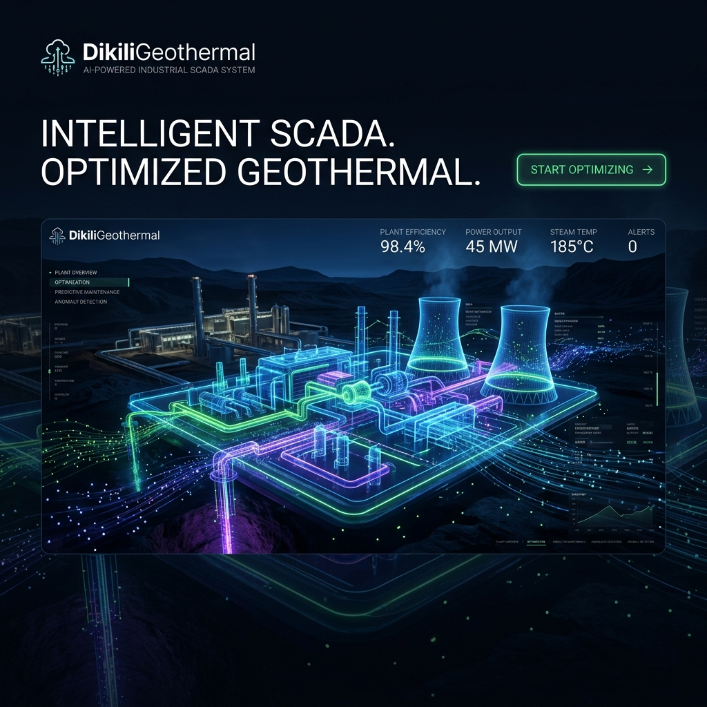
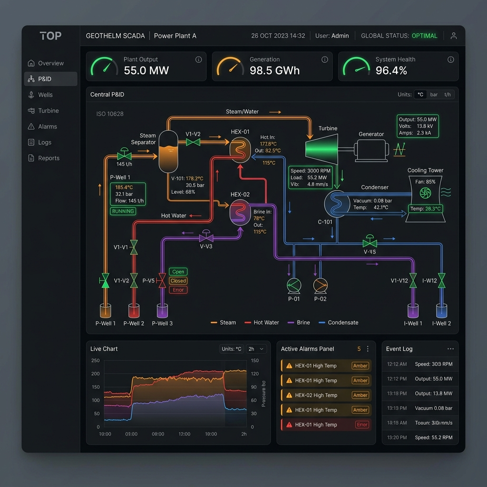

<div align="center">
  
  
  <h1>DikiliGeothermal SCADA & Digital Twin</h1>
  <p><b>AI-Powered Industrial Automation Platform</b></p>
  
  [](#)
  [](#)
  [](#)
  [](#)
  [](#)
</div>

## 📖 Overview
DikiliGeothermal is an enterprise-grade, highly decoupled SCADA (Supervisory Control and Data Acquisition) system. It merges traditional industrial protocols (OPC UA, Modbus TCP, MQTT) with a modern Python-based Digital Twin and real-time AI anomaly detection engine.

Designed for the rigors of geothermal power extraction, the architecture strictly decouples the UI from the physical hardware via a unified **Driver Abstraction Layer (DAL)**, ensuring unparalleled testing reliability and zero-regression deployment.

<div align="center">
  
</div>

## ✨ Key Features
- 🔌 **Universal Driver Abstraction**: Write logic once. Deploy to Simulation, OPC UA, or Modbus TCP without changing a single line of business code.
- 🧠 **AI-Assisted Prediction**: Built-in Enterprise Scheduler continuously feeds the Historian pipeline into an anomaly detection engine, predicting equipment failure before the ISA-18.2 alarms trip.
- 🛡️ **Self-Healing Reliability**: Circuit Breakers and Watchdogs automatically isolate failing subsystems and attempt safe recovery sequences.
- 📉 **Digital Twin Engine**: Contains a strict software loop mimicking real-world thermodynamic properties, allowing operators to safely test "What-If" scenarios.

## 🚀 5-Minute Quick Start
To launch the platform in full Simulation mode (no physical PLC required):

```bash
# 1. Clone the repository
git clone https://github.com/organization/DikiliGeothermal.git
cd DikiliGeothermal

# 2. Setup the Python Environment
python -m venv .venv
source .venv/bin/activate  # On Windows: .venv\Scripts\activate
pip install -r requirements.txt

# 3. Launch in Simulation Mode
APP_ENV=simulation python -m core.main
```

## 📚 Comprehensive Documentation
Our documentation is academic-grade and designed for rapid onboarding.
- **[Full Documentation Index](docs/README.md)**
- **[System Architecture Diagrams](docs/diagrams/system_architecture.md)**
- **[API References](docs/api/scada_core.md)**
- **[Operator Manual](docs/operators/operator_manual.md)**
- **[How to Add a New Driver](docs/developers/extensions/add_driver.md)**

## 🤝 Contributing
We maintain a strict **Zero Regression** policy. Please review our [Contributing Guidelines](CONTRIBUTING.md) and [Coding Standards](docs/developers/documentation_standards.md) before submitting a Pull Request.

## 📄 License & Citation
This project is licensed under the MIT License - see the [LICENSE](LICENSE) file for details.

If you use this architecture for academic research, please cite:
> DikiliGeothermal SCADA Architecture (2026). "Decoupling Hardware via Abstraction Layers in IIoT Pipelines."
